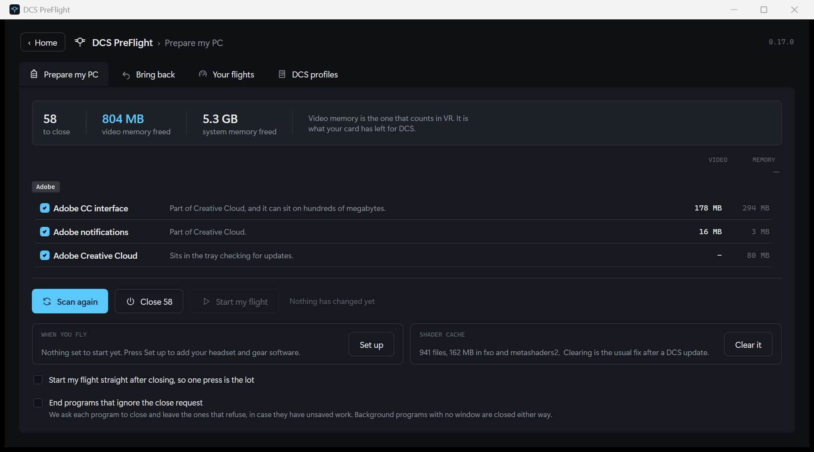
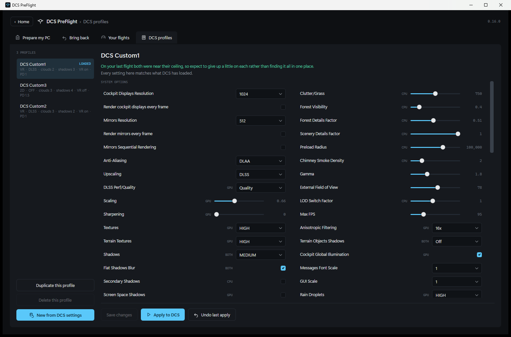

# DCS PreFlight

A free Windows app that gets your PC ready for a VR flight in DCS World, and tells you
afterwards what was actually holding that flight back.

No installer, no account, no network. One file, run it.



## What it does

**Before you fly.** It shows you what is running in the background, what each one is costing
you in video and system memory, and which ones are safe to close. Fifty-odd background
programs is normal on a machine that gets used for anything other than flying. Video memory
is the figure that matters in VR, so that is the one it leads with.

It asks each program to close politely and leaves anything that refuses, in case you have
unsaved work in it. **Bring back** puts them all back when you have landed.

Then it starts the other half of your VR stack: the headset streamer, whatever drives your
base or your pedals, anything doing haptics. You set that list up once, drag it into the
order you want, and it can start DCS last once the rest are up. Tick one box and closing runs
straight on into starting, so a single press is the whole pre-flight.

It will also clear DCS's shader cache, which is the usual fix after a DCS update. It tells
you what it will delete and that the next flight will load slowly, before anything goes.

**After you fly.** Leave recording on and it measures each flight by itself: it starts when
DCS starts, stops when DCS closes, and samples every ten seconds. Afterwards it tells you
whether your processor or your graphics card was the limit, because the answer changes which
settings are worth touching. Dropping your resolution does nothing for you when your card is
already sitting idle.

It then gives you a short list of settings worth changing, in order. Click one and it takes
you straight to that setting, boxed, in the profile DCS has loaded. Anything you have already
changed drops off the list, so you are never told to turn off something you turned off last
month.

**DCS profiles.** DCS gives you three preset slots on its load screen. This holds as many as
you like, saved in DCS's own preset format, laid out with DCS's own labels in DCS's own order
so you are not learning a second vocabulary. Keep one per map, one for night, one for the
days you want screenshots. Each setting is tagged with whether it costs you processor or
graphics card, with the reason on hover.



## Download

Grab `DCS-PreFlight-0.17.0.exe` from the [Releases](../../releases) page. It is about 62 MB
because everything it needs is inside it. There is nothing to install and nothing to
configure. Put it anywhere you like and run it.

SHA-256 of the 0.17.0 build:

```
9b2c1add487f1a2399418b23ecdc4ed0e03a0a4e798531a740c44eabf915668e
```

Check it before you run it if you like:

```powershell
Get-FileHash .\DCS-PreFlight-0.17.0.exe -Algorithm SHA256
```

### Windows will warn you the first time

You will get **"Windows protected your PC"**. That is SmartScreen, and it says that about any
program that is not code signed. Signing certificates cost a few hundred a year, and this is
free, so for now it is not signed. Click **More info**, then **Run anyway**. Verifying the
hash above is the real check, and it is a better one.

## What it needs

- Windows 10 or 11, 64-bit
- DCS World
- Nothing else. The .NET runtime is inside the download.

## Updating

From 0.17.0 on it updates itself. When a new version is out you get a small **Update to
x.y.z** button next to the version number; press it to see what changed and take it or leave
it. Nothing downloads until you say so, and the download is checked against the published
checksum before anything is replaced.

If you are on 0.16.0 you will need to download 0.17.0 by hand this once, since the older
build has no updater in it.

## If it cannot find DCS

It looks in the Saved Games folder Windows reports, which follows that folder if you have
moved it to another drive or let OneDrive redirect it. It does not need to be run from any
particular place, and there is nothing to configure first.

If it still cannot find it, open **DCS profiles** and press **Tell us where DCS is**. Point it
at either your Saved Games folder or the DCS folder inside it. Both work, and it checks the
folder before it keeps it, so a wrong one says so straight away.

## What it can and cannot measure

Worth knowing before you download it, because one of these depends on your headset.

| Figure | Needs |
|---|---|
| Background programs and memory | Any PC |
| Graphics card load and power | An NVIDIA card. It reads `nvidia-smi`, which ships with the driver. |
| Missed frames | A Pimax headset. It reads the Pimax runtime log. |

On other hardware those rows read `n/a` rather than guessing. Everything else still works,
including the profile editor and the background scan.

## What it reads, and what it changes

Mostly it reads.

- The scan reads your process list and their memory. It changes nothing until you press the
  button.
- Recording a flight runs `nvidia-smi` every ten seconds while DCS is open. That is it.
- It closes a background program only when you ask it to, and **Bring back** restores them.
- It writes to DCS's own options file only when you press **Apply**, and it copies your
  current settings first. **Undo last apply** puts them back.

Nothing about you leaves your machine. There is no telemetry and no account. Everything it
keeps lives in `%LOCALAPPDATA%\DCS-PreFlight`, and you can delete that folder whenever you
like.

One thing does use the network, and only one. On start it reads this project's release list
on GitHub to see whether there is a newer version, and if there is, it offers it. That
request sends nothing about you, your machine or what you fly. If you take the update, it
downloads the new file, checks it against the checksum published with the release, and only
then puts it in place. You can turn the whole thing off with **Tell me when there is a newer
version** on the Prepare tab, and then it never goes anywhere at all.

## Terms

Free to download and use, for anything, including recording video with it.

Provided as is, with no warranty of any kind. You run it at your own risk.

Please link people here rather than reuploading the file, and do not redistribute modified
copies of it.

## Not affiliated

Not affiliated with or endorsed by Eagle Dynamics, Pimax, or NVIDIA. DCS World is Eagle
Dynamics' software, and this is a separate tool that reads its settings file.
